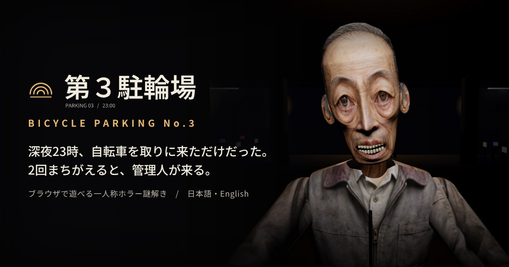

# 第３駐輪場 / Bicycle Parking No.3

深夜23時。5階に停めた自転車を取りに来ただけだった。停電で閉じ込められたエレベーターを動かすには、各階の駐輪車を数えて「照合票」に答えるしかない。2回続けて間違えると、管理人が来る。ブラウザで遊べる、完全一人称の短編ホラー謎解きです。インストール不要、日本語 / English。

**▶ 遊ぶ：https://infoairen7.github.io/daisan-churinjo/**
（English: https://infoairen7.github.io/daisan-churinjo/?lang=en ）



> 突然の大きな音、閃光、画面に向かって飛びかかってくる演出があります。「設定」で驚かし演出と点滅を弱められます。

## 特徴

- **毎回変わる謎**：5F〜2Fの4フロアで、駐輪車の配置と照合票（12種類の出題）が周回ごとに作られます。条件に合う自転車を調べて数え、台数を左から入力。答えの各桁は必ず1〜5です。
- **3つの結末**：誤答0回のシークレットエンド、帰宅エンド、そして管理人と目が合うゲームオーバー（同じ階から再開できます）。
- **怖さの作り**：下の階ほど暗く弱っていく照明、コンクリートに響く足音とノック、階ごとに一度だけ起きる異変、場面で変わるBGM、画面の向こうから飛びかかってくる管理人。
- **Xでポスト**：ゲームオーバーやクリアの画面から、どのフロアまで進んだか・誤答の回数・クリア記録をXに投稿できます。
- **日本語 / English**：ブラウザの言語で自動で切り替わり、タイトル画面と設定からも変えられます。
- PCはキーボード、スマホは十字キーとダブルタップ（横画面推奨）。外部ライブラリを使わない自前の WebGL2 エンジンで動いています。

## 操作

| 操作 | PC | スマホ |
| --- | --- | --- |
| 前進／後退 | W／S（↑／↓）長押し | 十字キー 上／下 |
| 向きを変える | A／D（←／→） | 十字キー 左／右 |
| 早歩き | Shift | ― |
| 見回す（任意） | マウスでドラッグ | 画面をドラッグ |
| 調べる・選ぶ | Space | 同じ対象をダブルタップ |
| 道具 | I | 「道具」ボタン |
| 照合盤の数字 | 1〜5、Backspace で「閉」 | 各ボタンをダブルタップ |
| 一時停止・閉じる | Esc | 右上の一時停止 |

## フォルダ

| 場所 | 中身 |
| --- | --- |
| `src/engine/` | 自前の WebGL2 描画エンジン（GLBローダー、モーフ、アニメーション、霧、トーンマップ） |
| `src/game/` | 進行、照合（謎）エンジン、恐怖演出、UI、音、日本語／英語 |
| `public/` | ページの雛形と素材（3Dモデル GLB、効果音 WAV、BGM MP3、UI画像） |
| `docs/` | GitHub Pages で公開しているビルド済みのゲーム |
| `tools/` | ビルド、BGMの作曲スクリプト、謎の検証、自動プレイテスト |
| `media/` | サムネイルとスクリーンショット |

実装の経緯や企画書との違い、検証の記録は [DEVELOPMENT.md](DEVELOPMENT.md) にまとめています。

## ビルド

Node.js 18 以上が必要です。

```
npm install
npm run build:web     # docs/ を作る（GitHub Pages 用）
npm run build         # dist/ を作る（claude.ai アーティファクト用）
npm run serve         # dist/ を http://localhost:8765/local.html で確認
```

BGM とスティンガーは `python3 tools/compose_music.py public/assets/music` で作り直せます（numpy、scipy、ffmpeg が必要）。

## テスト

Playwright（Chromium）が必要です。テスト用のフックを入れたビルドで動かします。

```
npm run build:debug
npm run serve &
node tools/playtest.mjs out/playtest            # 全分岐の通しプレイ
node tools/playtest_endings.mjs out/endings     # 2つのエンディング
node tools/run_ts.mjs tools/validate_puzzles.ts # 謎の生成を4万回検証
```

## ライセンス

[MIT License](LICENSE)。外部のライブラリや素材は使っていません（文字は Google Fonts の Noto Sans JP を読み込んでいます）。

3Dモデル・効果音・UI素材はこの作品のために用意した素材パックのものです。ゲームのコード、文章、BGM は Anthropic の AI「Claude」と一緒に作りました。

---

## English

**Bicycle Parking No.3** is a short first-person puzzle horror game that runs in your browser.

It's 11 p.m. and you only came back for your bike on the fifth floor. A power cut traps you in the elevator, and the only way down is to count the parked bicycles on each floor and answer the checklist. Get it wrong twice in a row and the caretaker comes.

**Play: https://infoairen7.github.io/daisan-churinjo/?lang=en**

- A new layout and new checklists (12 kinds) on every run, across four floors. Every answer digit is 1–5.
- Three outcomes: a secret ending for a run with no wrong answers, the "Home" ending, and a game over you can retry from the same floor.
- Contains sudden loud sounds, flashes and jump scares. You can tone them down in Settings.
- Post how far you got to X from the game over and ending screens.
- Japanese and English (picked from your browser language; switch on the title screen or in Settings).
- Keyboard on PC; D-pad and double-tap on phones (landscape recommended). Custom WebGL2 engine, no external libraries.
- Build: `npm install && npm run build:web` (Node 18+). Tests: `npm run build:debug`, then `tools/playtest*.mjs` (Playwright).
- License: MIT. Code, text and music made with the help of Claude, Anthropic's AI.
